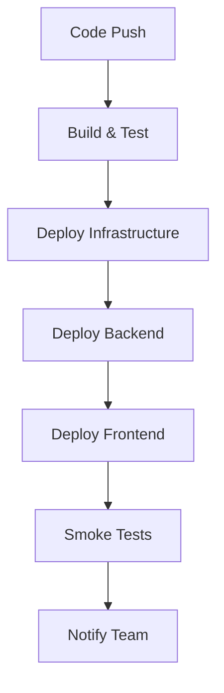
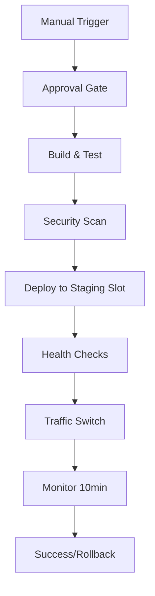

# S7.1 Deployment Operations Guide

## Overview

This guide provides comprehensive documentation for deploying and managing the Meeting Summary application across development and production environments using the automated CI/CD pipeline system.

## **🚀 Quick Start**

### Development Deployment
```bash
# Development deployment happens automatically on any code push
git add .
git commit -m "Your changes"
git push origin your-branch-name

# Monitor deployment at:
# https://github.com/jonathan-hamilton/meeting-summarizer/actions
```

### Production Deployment
```bash
# Production deployment requires manual approval
1. Navigate to GitHub Actions
2. Select "Deploy to Production" workflow
3. Click "Run workflow"
4. Wait for approval gate
5. Monitor deployment progress
```

---

## **📋 Pre-Deployment Checklist**

### Development Deployment
- [ ] All unit tests pass locally
- [ ] Code review completed (if required)
- [ ] No breaking changes to API contracts
- [ ] Database migrations tested locally

### Production Deployment
- [ ] All development deployments successful
- [ ] Security scan passed
- [ ] Performance testing completed
- [ ] Database migration scripts reviewed
- [ ] Rollback plan documented
- [ ] On-call team notified
- [ ] Business stakeholders informed
- [ ] Maintenance window scheduled (if required)

---

## **🔧 Pipeline Architecture**

### Development Pipeline Flow


### Production Pipeline Flow


---

## **🌍 Environment Configuration**

### Development Environment
- **Resource Group**: `rg-meetingsummary-dev`
- **App Service**: `app-meetingsummary-dev`
- **Database**: `sql-meetingsummary-dev`
- **Storage**: `sameetingsummarydev`
- **URL**: `https://app-meetingsummary-dev.azurewebsites.net`

**Characteristics**:
- Automatic deployment on code push
- Basic tier resources for cost optimization
- Enhanced debugging and logging
- Open network access for development team

### Production Environment
- **Resource Group**: `rg-meetingsummary-prod`
- **App Service**: `app-meetingsummary-prod`
- **Staging Slot**: `app-meetingsummary-prod/staging`
- **Database**: `sql-meetingsummary-prod`
- **Storage**: `sameetingsummaryprod`
- **URL**: `https://app-meetingsummary-prod.azurewebsites.net`

**Characteristics**:
- Manual approval required for deployment
- Premium tier resources for performance
- Blue-green deployment with staging slots
- Restricted network access and enhanced security
- Comprehensive monitoring and alerting

---

## **📖 Deployment Procedures**

### Standard Development Deployment

1. **Code Changes**
   ```bash
   git checkout -b feature/your-feature
   # Make your changes
   git add .
   git commit -m "feat: your feature description"
   git push origin feature/your-feature
   ```

2. **Automatic Pipeline Execution**
   - Pipeline triggers automatically
   - Build and test execution (5-10 minutes)
   - Infrastructure deployment via Terraform
   - Application deployment to development environment
   - Smoke tests validation

3. **Verification**
   ```bash
   # Check deployment status
   curl https://app-meetingsummary-dev.azurewebsites.net/health
   
   # View detailed health
   curl https://app-meetingsummary-dev.azurewebsites.net/health/detailed
   ```

### Standard Production Deployment

1. **Prepare for Production**
   ```bash
   # Ensure main branch is up to date
   git checkout main
   git pull origin main
   
   # Verify development deployment is successful
   # Confirm all tests pass
   ```

2. **Initiate Production Deployment**
   - Navigate to GitHub Actions
   - Select "Deploy to Production" workflow
   - Click "Run workflow" button
   - Select "production" environment
   - Click "Run workflow"

3. **Approval Process**
   - Deployment waits for manual approval
   - Release team reviews pre-deployment checklist
   - Approve deployment to proceed

4. **Monitor Deployment**
   - Build and test execution (10-15 minutes)
   - Security scanning
   - Deployment to staging slot
   - Health checks validation
   - Traffic switch to new version
   - 10-minute monitoring period

5. **Post-Deployment Verification**
   ```bash
   # Check production health
   curl https://app-meetingsummary-prod.azurewebsites.net/health
   
   # Monitor for errors
   # Check Application Insights dashboard
   # Verify user-facing functionality
   ```

### Emergency Production Deployment

1. **Emergency Override**
   - Use workflow dispatch with emergency flags
   - Skip approval gate if authorized
   - Accelerated deployment process

2. **Emergency Command**
   ```bash
   # GitHub CLI approach
   gh workflow run "Deploy to Production" \
     --field environment=production \
     --field skip-tests=true \
     --field skip-approval=true
   ```

3. **Immediate Post-Deployment Actions**
   - Enhanced monitoring for 30 minutes
   - Team notification of emergency deployment
   - Documentation of emergency justification

---

## **🔄 Rollback Procedures**

### Automatic Rollback Triggers
- Health check failures (3 consecutive failures)
- Error rate > 5% for 2 minutes
- Response time > 2 seconds for 5 minutes

### Manual Rollback Options

#### Option 1: GitHub Actions Rollback Workflow
```bash
# Will be implemented in future iteration
gh workflow run "Emergency Rollback" --field app-service=app-meetingsummary-prod
```

#### Option 2: Azure Portal Slot Swap
1. Open Azure Portal
2. Navigate to App Service: `app-meetingsummary-prod`
3. Go to "Deployment slots"
4. Click "Swap" between production and staging
5. Confirm swap operation

#### Option 3: Azure CLI Rollback
```bash
# Install rollback script
chmod +x .github/scripts/rollback.sh

# Execute rollback
./.github/scripts/rollback.sh \
  --app-service app-meetingsummary-prod \
  --type slot-swap \
  --yes
```

#### Option 4: Emergency Script
```bash
# Quick rollback using Azure CLI
az webapp deployment slot swap \
  --name app-meetingsummary-prod \
  --resource-group rg-meetingsummary-prod \
  --slot staging \
  --target-slot production
```

### Rollback Verification
```bash
# Check rollback success
curl https://app-meetingsummary-prod.azurewebsites.net/health

# Verify application functionality
# Check error rates in monitoring dashboard
# Confirm user reports of issue resolution
```

---

## **🔍 Monitoring & Health Checks**

### Health Check Endpoints

#### Basic Health Check
```bash
GET /health
Response: 200 OK
```

#### Detailed Health Check
```bash
GET /health/detailed
Response: {
  "status": "healthy",
  "database": { "status": "healthy", "responseTime": "23ms" },
  "storage": { "status": "healthy", "responseTime": "15ms" },
  "keyvault": { "status": "healthy", "responseTime": "45ms" },
  "openai": { "status": "healthy", "responseTime": "120ms" }
}
```

#### Ready Check
```bash
GET /health/ready
Response: 200 OK (when ready for traffic)
```

### Monitoring Dashboards

#### Development Environment
- **Application Insights**: Basic telemetry and debugging
- **Azure Monitor**: Resource utilization
- **GitHub Actions**: Deployment status and history

#### Production Environment
- **Application Insights**: Comprehensive telemetry, custom metrics
- **Azure Monitor**: Resource utilization, alerting rules
- **Log Analytics**: Centralized logging and analysis
- **Custom Dashboards**: Business metrics, performance KPIs

### Key Metrics to Monitor

#### Application Performance
- Response time (target: < 1 second P95)
- Error rate (target: < 1%)
- Throughput (requests per minute)
- Memory usage (target: < 80%)
- CPU usage (target: < 70%)

#### Business Metrics
- Active users
- Transcription requests per hour
- Token consumption rate
- User registration rate
- Feature usage patterns

#### Infrastructure Metrics
- Database performance (query times, connections)
- Storage usage and performance
- Network latency and bandwidth
- Azure service health status

---

## **🚨 Troubleshooting Guide**

### Common Deployment Issues

#### Issue: Build Failures
**Symptoms**: Build step fails in CI/CD pipeline
**Investigation**:
```bash
# Check build logs in GitHub Actions
# Look for compilation errors or test failures
# Verify all dependencies are available
```
**Resolution**:
- Fix compilation errors in code
- Update package references
- Resolve test failures
- Re-run pipeline

#### Issue: Infrastructure Deployment Failures
**Symptoms**: Terraform apply fails
**Investigation**:
```bash
# Check Terraform logs in pipeline
# Verify Azure service availability
# Check resource quotas and limits
# Validate Terraform state consistency
```
**Resolution**:
- Verify Azure resource availability
- Check subscription quotas
- Resolve naming conflicts
- Fix Terraform configuration issues

#### Issue: Application Deployment Failures
**Symptoms**: Application doesn't start after deployment
**Investigation**:
```bash
# Check App Service logs
az webapp log tail --name app-meetingsummary-prod --resource-group rg-meetingsummary-prod

# Check application insights for startup errors
# Verify connection strings and app settings
# Check managed identity permissions
```
**Resolution**:
- Fix application configuration issues
- Update connection strings
- Verify Key Vault access permissions
- Check database connectivity

#### Issue: Health Check Failures
**Symptoms**: Health checks return non-200 status codes
**Investigation**:
```bash
# Test health endpoints manually
curl -v https://app-meetingsummary-prod.azurewebsites.net/health

# Check detailed health response
curl https://app-meetingsummary-prod.azurewebsites.net/health/detailed

# Review application logs for errors
```
**Resolution**:
- Identify failing dependency (database, storage, etc.)
- Fix connection issues
- Update health check implementation
- Verify external service availability

### Performance Issues

#### Issue: Slow Response Times
**Symptoms**: Response times > 2 seconds
**Investigation**:
- Check Application Insights performance tab
- Review database query performance
- Monitor external API response times
- Check App Service resource utilization

**Resolution**:
- Optimize database queries
- Scale App Service plan if needed
- Implement caching where appropriate
- Optimize external API calls

#### Issue: High Error Rates
**Symptoms**: Error rate > 1%
**Investigation**:
- Check Application Insights failures tab
- Review exception details and stack traces
- Monitor dependency failure rates
- Check recent deployment correlation

**Resolution**:
- Fix application bugs causing errors
- Improve error handling and retry logic
- Address dependency reliability issues
- Consider rollback if error rate is critical

### Security Issues

#### Issue: Authentication Failures
**Symptoms**: 401/403 errors in application
**Investigation**:
- Check JWT token configuration
- Verify Key Vault access permissions
- Review authentication middleware logs
- Test authentication flow manually

**Resolution**:
- Update JWT configuration
- Fix Key Vault access policies
- Verify authentication endpoint configuration
- Update client-side authentication logic

---

## **📊 Performance Baselines**

### Development Environment Targets
- **Deployment Time**: < 10 minutes
- **Health Check Response**: < 5 seconds
- **Basic Functionality**: All core features working
- **Error Rate**: < 5% (acceptable for development)

### Production Environment Targets
- **Deployment Time**: < 20 minutes (including approval)
- **Response Time P95**: < 1 second
- **Error Rate**: < 1%
- **Availability**: > 99.9%
- **Rollback Time**: < 5 minutes

### SLA Commitments
- **API Availability**: 99.9% uptime
- **Response Time**: 95% of requests < 1 second
- **Error Rate**: < 0.5% under normal conditions
- **Deployment Frequency**: Up to 5 deployments per week
- **Recovery Time**: < 30 minutes for critical issues

---

## **📞 Support Contacts**

### Development Environment Issues
- **Primary Contact**: Development Team
- **Escalation**: DevOps Team
- **Response Time**: Next business day

### Production Environment Issues
- **Primary Contact**: On-Call Engineer (24/7)
- **Escalation Path**: 
  1. Senior Engineer (15 minutes)
  2. Engineering Manager (30 minutes)
  3. CTO (1 hour)
- **Response Time**: 
  - Critical: 15 minutes
  - High: 1 hour
  - Medium: 4 hours
  - Low: Next business day

### Emergency Contacts
- **Production Outage**: [on-call phone number]
- **Security Incident**: [security team contact]
- **Data Loss Event**: [data protection officer]

---

## **📚 Additional Resources**

### Documentation Links
- [Azure App Service Documentation](https://docs.microsoft.com/en-us/azure/app-service/)
- [GitHub Actions Documentation](https://docs.github.com/en/actions)
- [Terraform Azure Provider](https://registry.terraform.io/providers/hashicorp/azurerm/latest/docs)

### Internal Resources
- [Architecture Overview](../features/architecture.md)
- [Security Guidelines](../architecture/security-guidelines.md)
- [Testing Strategy](../testing/testing-strategy.md)
- [Incident Response Plan](../operations/incident-response.md)

### Team Resources
- **Slack Channels**: 
  - `#engineering-alerts` (automated alerts)
  - `#deployments` (deployment notifications)
  - `#production-support` (production issues)
- **Wiki**: [Internal deployment procedures]
- **Runbooks**: [Detailed operational procedures]

---

**Document Version**: 1.0  
**Last Updated**: October 9, 2025  
**Next Review**: November 9, 2025  
**Owner**: DevOps Team