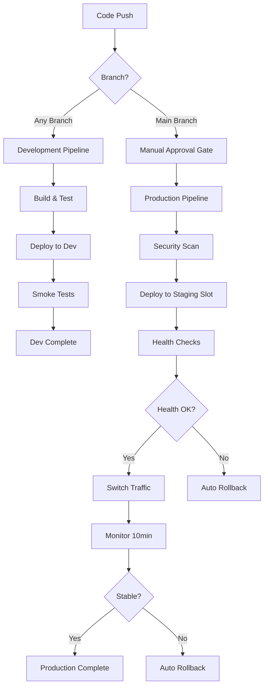

# S7.1 CI/CD Pipeline Architecture Design

## Pipeline Overview

This document defines the comprehensive GitHub Actions CI/CD pipeline architecture for the Meeting Summary application, supporting automated development deployment and controlled production releases.

## **🏗️ Architecture Diagram**



## **🔄 Workflow Structure**

### **1. Development Workflow**
**File**: `.github/workflows/deploy-development.yml`
**Trigger**: Push to any branch
**Purpose**: Continuous deployment to development environment

```yaml
name: Deploy to Development
on:
  push:
    branches: ['*']
  workflow_dispatch:

concurrency:
  group: dev-deployment-${{ github.ref }}
  cancel-in-progress: true

jobs:
  build-and-test:
    runs-on: ubuntu-latest
    environment: development
    
  deploy-backend:
    needs: build-and-test
    runs-on: ubuntu-latest
    environment: development
    
  deploy-frontend:
    needs: build-and-test
    runs-on: ubuntu-latest
    environment: development
    
  smoke-tests:
    needs: [deploy-backend, deploy-frontend]
    runs-on: ubuntu-latest
    environment: development
```

### **2. Production Workflow**
**File**: `.github/workflows/deploy-production.yml`
**Trigger**: Manual dispatch with approval
**Purpose**: Controlled production deployment with blue-green strategy

```yaml
name: Deploy to Production
on:
  workflow_dispatch:
    inputs:
      environment:
        description: 'Target environment'
        required: true
        default: 'production'
        type: choice
        options:
        - production

concurrency:
  group: prod-deployment
  cancel-in-progress: false

jobs:
  approval-gate:
    runs-on: ubuntu-latest
    environment: production-approval
    
  security-scan:
    needs: approval-gate
    runs-on: ubuntu-latest
    
  deploy-staging-slot:
    needs: security-scan
    runs-on: ubuntu-latest
    environment: production
    
  health-checks:
    needs: deploy-staging-slot
    runs-on: ubuntu-latest
    environment: production
    
  traffic-switch:
    needs: health-checks
    runs-on: ubuntu-latest
    environment: production
    
  monitoring:
    needs: traffic-switch
    runs-on: ubuntu-latest
    environment: production
```

### **3. Shared Workflow Components**
**File**: `.github/workflows/shared-build.yml`
**Purpose**: Reusable build and test logic

```yaml
name: Shared Build and Test
on:
  workflow_call:
    inputs:
      environment:
        required: true
        type: string
    outputs:
      backend-artifact:
        description: "Backend build artifact"
        value: ${{ jobs.build-backend.outputs.artifact-name }}
      frontend-artifact:
        description: "Frontend build artifact"
        value: ${{ jobs.build-frontend.outputs.artifact-name }}
```

## **🔐 Security & Authentication**

### **Azure OIDC Configuration**
**Setup**: Azure Workload Identity with GitHub OIDC
**Benefits**: No stored secrets, automatic token rotation, audit trail

```yaml
# Required GitHub Environment Variables
AZURE_CLIENT_ID: # Azure App Registration Client ID
AZURE_TENANT_ID: # Azure Tenant ID
AZURE_SUBSCRIPTION_ID: # Azure Subscription ID

# Per-Environment Configuration
development:
  AZURE_CLIENT_ID: ${{ secrets.AZURE_CLIENT_ID_DEV }}
  RESOURCE_GROUP: rg-meetingsummary-dev
  
production:
  AZURE_CLIENT_ID: ${{ secrets.AZURE_CLIENT_ID_PROD }}
  RESOURCE_GROUP: rg-meetingsummary-prod
```

### **GitHub Environments Configuration**

#### **Development Environment**
```yaml
Environment: development
Protection Rules: None (auto-deploy)
Secrets:
  - AZURE_CLIENT_ID_DEV
  - TERRAFORM_BACKEND_KEY_DEV
Variables:
  - AZURE_RESOURCE_GROUP=rg-meetingsummary-dev
  - APP_SERVICE_NAME=app-meetingsummary-dev
```

#### **Production Environment**
```yaml
Environment: production
Protection Rules:
  - Required reviewers: 2 (from admin team)
  - Wait timer: 0 minutes
  - Restrict to main branch only
Secrets:
  - AZURE_CLIENT_ID_PROD
  - TERRAFORM_BACKEND_KEY_PROD
Variables:
  - AZURE_RESOURCE_GROUP=rg-meetingsummary-prod
  - APP_SERVICE_NAME=app-meetingsummary-prod
```

#### **Production Approval Environment**
```yaml
Environment: production-approval
Protection Rules:
  - Required reviewers: 1 (from release team)
  - Business hours restriction: 9 AM - 5 PM EST
Purpose: Manual gate for production deployments
```

## **🧪 Testing Strategy**

### **Test Execution Order**
```yaml
1. Unit Tests (.NET + React)
   - Coverage requirement: 80%+
   - Fail-fast on test failures
   - Parallel execution for speed

2. Integration Tests
   - Database integration tests
   - API endpoint tests
   - Authentication flow tests

3. Security Scanning
   - OWASP ZAP baseline scan
   - Dependency vulnerability scan
   - Configuration security check

4. Smoke Tests
   - Health endpoint validation
   - Critical path verification
   - Database connectivity test

5. End-to-End Tests (Production only)
   - Full user workflow simulation
   - Cross-browser compatibility
   - Performance baseline validation
```

### **Test Configuration**

#### **Unit Tests Configuration**
```yaml
Backend (.NET):
  - Framework: xUnit
  - Coverage: Coverlet
  - Minimum Coverage: 80%
  - Test Categories: Unit, Integration
  
Frontend (React):
  - Framework: Vitest
  - Coverage: V8
  - Minimum Coverage: 70%
  - Test Types: Unit, Component, Integration
```

#### **Integration Tests Setup**
```yaml
Database:
  - Test Database: In-memory SQLite
  - Migration: Automatic on test start
  - Cleanup: Database reset per test class
  
API Tests:
  - Framework: ASP.NET Core Test Host
  - Authentication: Test JWT tokens
  - Scope: All controller endpoints
```

## **🚀 Deployment Strategy**

### **Blue-Green Deployment Implementation**

#### **Azure App Service Slots**
```yaml
Production Slot:
  - Name: production
  - URL: https://app-meetingsummary-prod.azurewebsites.net
  - Traffic: 100% (during normal operation)
  - Purpose: Stable, production traffic

Staging Slot:
  - Name: staging
  - URL: https://app-meetingsummary-prod-staging.azurewebsites.net
  - Traffic: 0% (until validation complete)
  - Purpose: New deployment validation
```

#### **Traffic Switching Logic**
```yaml
1. Deploy to Staging Slot
   - Zero traffic initially
   - Run health checks against staging URL
   - Validate database connectivity
   - Test critical API endpoints

2. Health Check Validation
   - HTTP 200 response from /health endpoint
   - Database connection successful
   - Key Vault access verified
   - Storage account connectivity confirmed

3. Traffic Switch
   - Instant swap: staging becomes production
   - Old production becomes staging
   - 100% traffic moved immediately
   - Monitor for 10 minutes

4. Rollback Trigger
   - Health check failures
   - Error rate > 5% for 2 minutes
   - Response time > 2 seconds average
   - Manual trigger via GitHub Actions
```

### **Database Migration Strategy**
```yaml
Development Environment:
  - Automatic migration on deployment
  - Database reset allowed for testing
  - No backup required

Production Environment:
  - Manual migration review required
  - Automatic backup before migration
  - Rollback script validation
  - Migration in separate job before app deployment
```

## **📊 Monitoring & Observability**

### **Health Check Endpoints**
```yaml
Basic Health: /health
  - Response: 200 OK
  - Checks: API availability
  
Detailed Health: /health/detailed
  - Response: JSON with component status
  - Checks: Database, Storage, Key Vault, External APIs
  
Ready Check: /health/ready
  - Response: 200 when ready for traffic
  - Used by: Load balancer and deployment validation
```

### **Deployment Monitoring**
```yaml
Key Metrics:
  - Response time (< 2 seconds average)
  - Error rate (< 5% for any 2-minute window)
  - Throughput (baseline comparison)
  - Database performance (query times)

Alerting Triggers:
  - Health check failures (immediate rollback)
  - Error rate spike (automated investigation)
  - Performance degradation (monitoring alert)
  - Security scan failures (deployment block)

Logging Integration:
  - Application Insights for .NET
  - Console logs for GitHub Actions
  - Azure Monitor for infrastructure
  - Correlation IDs across all components
```

## **🔄 Rollback Procedures**

### **Automatic Rollback Triggers**
```yaml
1. Health Check Failures
   - Failed /health endpoint (3 consecutive failures)
   - Database connectivity issues
   - Key Vault access failures

2. Performance Degradation
   - Response time > 2 seconds for 5 minutes
   - Error rate > 5% for 2 minutes
   - Throughput drop > 50% from baseline

3. Manual Triggers
   - GitHub Actions workflow dispatch
   - Azure portal manual slot swap
   - Emergency contact notification system
```

### **Rollback Execution**
```yaml
Application Rollback:
  1. Immediate slot swap (staging ↔ production)
  2. DNS updates automatic (Azure handles)
  3. Validation: old version health checks
  4. Notification: team alert of rollback
  
Database Rollback:
  1. Execute pre-generated rollback script
  2. Validate data integrity
  3. Test application connectivity
  4. Update migration tracking table

Infrastructure Rollback:
  1. Terraform state revert to previous version
  2. Azure resource configuration reset
  3. Validation of all resource connectivity
  4. Application restart with old configuration
```

## **📁 File Structure**

```
.github/
├── workflows/
│   ├── deploy-development.yml       # Dev environment deployment
│   ├── deploy-production.yml        # Prod environment deployment
│   ├── shared-build.yml            # Reusable build/test workflow
│   ├── infrastructure-deploy.yml    # Terraform deployment
│   └── security-scan.yml           # Security scanning workflow
├── environments/
│   ├── development.yml              # Dev environment config
│   ├── production.yml               # Prod environment config
│   └── shared.yml                   # Shared configuration
└── scripts/
    ├── health-check.sh              # Health validation script
    ├── rollback-trigger.sh          # Emergency rollback
    └── deployment-notify.sh         # Team notifications
```

## **🔧 Implementation Phases**

### **Phase 1: Foundation (Day 1)**
1. Create GitHub environments (dev, prod, prod-approval)
2. Configure Azure OIDC authentication
3. Set up shared build workflow
4. Implement basic development pipeline
5. Test development deployment automation

### **Phase 2: Production Pipeline (Day 2)**
1. Create production deployment workflow
2. Implement blue-green deployment slots
3. Configure health check automation
4. Set up manual approval gates
5. Test production deployment process

### **Phase 3: Advanced Features (Day 3)**
1. Implement automatic rollback triggers
2. Add comprehensive monitoring
3. Configure security scanning
4. Create operational runbooks
5. Validate end-to-end scenarios

---

**Architecture Version**: 1.0  
**Last Updated**: October 9, 2025  
**Status**: Design Complete - Ready for Implementation